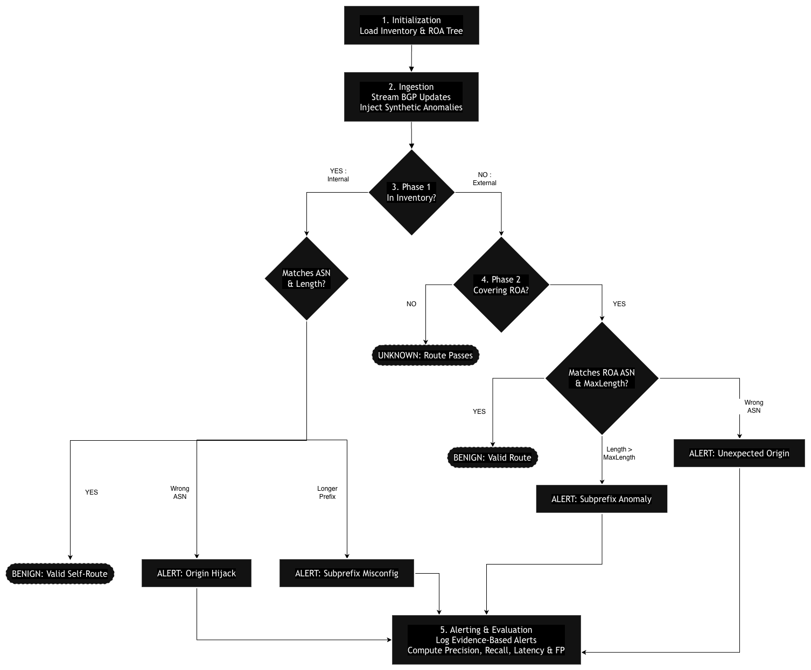

# Explainable BGP Origin and Subprefix Anomaly Monitor

A passive, rule-based BGP monitoring pipeline that detects **Unexpected-Origin Anomalies** and **More-Specific Subprefix Anomalies** using an internal **Operator Prefix Inventory** and time-aligned global **RPKI Route Origin Authorizations (ROAs)**.

Built in Python using `mrtparse` for streaming MRT decompression and C-backed `py-radix` binary Patricia tries for $O(K)$ prefix matching, the monitor outputs structured, human-readable, evidence-based alerts while minimizing false positives on legitimate Multi-Origin AS (MOAS) and delayed-ROA policy-change scenarios.


## Pipeline Architecture

Incoming BGP routing updates flow through a five-stage, dual-phase validation pipeline:



## Core Data Structures & Validation Design

* **Binary Patricia Trie (`py-radix`):** Both the Operator Prefix Inventory (`inventoryTree`) and the unified 5-RIR Global ROA Registry (`roaTree`) are indexed as C-backed Radix trees. Each CIDR block is mapped bitwise to a depth equal to its prefix length, enabling covering-prefix lookups (`search_covering`) in $O(K)$ time ($K \le 32$ for IPv4, $K \le 128$ for IPv6), independent of the total number of stored ROAs.

* **Prefix-Keyed Multi-ROA Storage:** Nodes in `roaTree` are keyed by IP prefix and store a list of `{'asn', 'max_length'}` records (`node.data['roas']`), natively supporting legitimate Multi-Origin AS (MOAS) routing.

* **Phase 1 Short-Circuiting:** Announcements covered by the internal `inventoryTree` are validated against the most specific owned block (`covering_nodes[0]`). Approved internal routes (`VALID_INTERNAL`) short-circuit Phase 2, preventing false positives during delayed-ROA policy migrations and protecting un-ROA'd internal prefixes.

* **RFC 6811 Subprefix Priority:** External announcements evaluated in Phase 2 exit early as `VALID` on the first authorizing ROA. If no ROA authorizes the route, a matching ASN exceeding `max_length` takes priority as `ROA_SUBPREFIX_ANOMALY` over `ROA_ORIGIN_ANOMALY`.

* **Malformed Prefix Guard:** Out-of-bounds mask lengths (e.g., IPv4 $> /32$ or IPv6 $> /128$) raise a `ValueError` in `py-radix`, which both phases catch and log as `MALFORMED_PREFIX`.

## Evolution of the ROA Storage Approach

Before adopting the C-backed Radix tree (`py-radix`) for the final pipeline, we explored three earlier ROA storage strategies whose limitations guided our final design: 
* A sequential **linear search** (`src/performance_when_using_linear_search_for_roa_storage.py`) that bottlenecked at $O(N)$ over hundreds of thousands of global ROAs. 
* a **hash-based approach** (`src/performance_when_using_hash_for_roa_storage.py`) that accelerated exact matches but required probing every possible parent mask length from `/prefix_len` down to `/0`.
* An **interval-based approach** (`src/performance_when_using_intervals_for_roa_storage.py`) modeling CIDR blocks as integer ranges `[start, end]` that introduced sorting and overlap-query overhead. 
* These trade-offs led directly to our final **Radix tree** implementation (`src/rad.py`, `src/benchmark.py`), which indexes prefixes bitwise by mask depth to resolve nested covering-prefix lookups in $O(K)$ time ($K \le 32$ for IPv4, $K \le 128$ for IPv6), independent of the global ROA table size.

## Repository Structure

```
.
├── data/
│   ├── roas/
│   ├── updates.20261001.0000.bz2
│   ├── updates.20261101.0000.bz2
│   ├── inventory.csv
│   ├── alerts.csv
│   └── synthetic_eval_results.csv
├── docs/
│   ├── Project Report.pdf
│   ├── 264101019_264101044_Project_Scope
├── src/
│   ├── constants.py
│   ├── generate_inventory.py
│   ├── rad.py
│   ├── generate_synthetic.py
│   ├── benchmark.py
│   ├── performance_when_using_hash_for_roa_storage.py
│   ├── performance_when_using_intervals_for_roa_storage.py
│   └── performance_when_using_linear_search_for_roa_storage.py
├── requirements.txt
└── README.md
```

## Setup & Data Provenance

### 1. Install Dependencies

Python 3.14.7 is used. Install the required libraries:

```
pip install -r requirements.txt

```

Core dependencies:

* `mrtparse==2.2.0` (dictionary-based MRT v2 parser)

* `py-radix==1.1.0` (C-backed IP prefix Radix tree)

### 2. Data Sources

* **BGP Feeds (RouteViews):** Compressed 15-minute MRT update archives from the University of Oregon RouteViews archive:

```
mkdir -p data && cd data
curl -O http://archive.routeviews.org/bgpdata/2026.10/UPDATES/updates.20261001.0000.bz2
curl -O http://archive.routeviews.org/bgpdata/2026.11/UPDATES/updates.20261101.0000.bz2

```

* **Time-Aligned Global ROAs:** Historical RPKI archives from all five Regional Internet Registries (ARIN, RIPE NCC, APNIC, LACNIC, AFRINIC) matching `2026-10-01`, downloaded from the RIPE NCC RPKI Archive (`https://ftp.ripe.net/rpki/`).

* `https://ftp.ripe.net/rpki/afrinic.tal/2026/10/01/`
* `https://ftp.ripe.net/rpki/apnic.tal/2026/10/01/`
* `https://ftp.ripe.net/rpki/arin.tal/2026/10/01/`
* `https://ftp.ripe.net/rpki/lacnic.tal/2026/10/01/`
* `https://ftp.ripe.net/rpki/ripencc.tal/2026/10/01/`

## Usage

Run the scripts in order from the repository root:

```
# 1. Generate the Operator Prefix Inventory for the selected active ASN (one-time setup) (writes data/inventory.csv)
python src/generate_inventory.py

# 2. Run the core monitor on the real-world BGP feed (writes data/alerts.csv)
python src/rad.py

# 3. Run the isolated synthetic evaluation (ROA-Only vs. Full Pipeline) (writes data/synthetic_eval_results.csv)
python src/generate_synthetic.py

# 4. Run pipeline stage breakdown, throughput, and 1-month time-alignment drift benchmarks
python src/benchmark.py

# To reproduce the performance measurements from the earlier approaches, from the repository root, run 
python src/performance_when_using_linear_search_for_roa_storage.py
python src/performance_when_using_hash_for_roa_storage.py
python src/performance_when_using_intervals_for_roa_storage.py 


```

> **Note:** `src/rad.py` operates strictly on real BGP feeds and real ROA snapshots without modifying any input files. Synthetic event injection is decoupled inside `src/generate_synthetic.py`, which imports the exact validation functions from `src/rad.py` and interleaves labelled synthetic events in memory.

## Sample Inventory Rows
Every row written to `data/inventory.csv` includes prefix, expected_asns, expected_max_len, category.

```
prefix,expected_asns,expected_max_len,category
167.249.168.0/22,262503|64512,22,policy_shift
167.249.168.0/24,262503,24,single
74.3.149.0/24,13559,24,unroa
```

## Sample Explainable Alerts

Every `INVALID` verdict logged to `data/alerts.csv` includes the Unix timestamp, validation phase, anomaly class, offending ASN, target prefix, and exact rule violated:

```
timestamp,phase,anomaly_type,prefix,origin_asn,evidence
1790812805,PHASE_1_INVENTORY,INVENTORY_ORIGIN_HIJACK,104.16.0.0/12,64555,"Inventory Origin Hijack: Unauthorized AS64555 announced 104.16.0.0/12 (owned block 104.16.0.0/12 expects ASNs ['13335'])."
1790812812,PHASE_2_ROA,ROA_SUBPREFIX_ANOMALY,198.51.100.0/25,64496,"Subprefix Anomaly: AS64496 is authorized for 198.51.100.0/24, but /25 exceeds ROA MaxLength /24."
```

## Key Evaluation Summary

Evaluated across **513,073 real BGP updates** (`updates.20261001.0000.bz2`) using single-operator inventory **AS262503**, benchmarked against **152 labelled synthetic events** (injected hijacks, subprefix misconfigurations, un-ROA'd internal attacks, MOAS routes, and delayed-ROA policy shifts) and a **1-month drifted feed** (`updates.20261101.0000.bz2`):

| Metric | ROA-Only Baseline (Phase 2) | Full Pipeline (Phase 1 + Phase 2) | 
| ----- | ----- | ----- | 
| **True Positives (TP)** | `111` | `117` | 
| **False Positives (FP)** | `3` | `0` | 
| **True Negatives (TN)** | `32` | `35` | 
| **False Negatives (FN)** | `6` | `0` | 
| **Precision** | `97.37%` | `100.00%` | 
| **Recall** | `94.87` | `100.00%` | 
| **F1-Score** | `0.961` | `1.0000` | 

### Systems Performance (`src/benchmark.py`)

* **Alert Latency (**$T_{\text{detect}} - T_0$**):** Sub-millisecond per-alert detection (fill exact Mean, Median, P95, and Max in $\mu\text{s}$ from `src/generate_synthetic.py`).

* **Throughput & Stage Breakdown:** Reports ROA Radix build time, MRT `.bz2` parsing time, Phase 1 overhead, and end-to-end updates/sec.

* **Time-Alignment Drift:** Empirically quantifies the increase in `INVALID` alerts when validating `2026-11-01` BGP updates against `2026-10-01` ROAs.

## Scope Boundaries & Limitations

This project is strictly a passive, rule-based control-plane monitor. The following features are intentionally out of scope:

* **No Automatic Mitigation:** Does not perform active route blocking or blackholing.

* **No Path-Forgery or Route-Leak Detection:** Does not analyze full `AS_PATH` sequences or valley-free routing policies.

* **Rule-Based Baseline Only:** Focuses strictly on deterministic RFC 6811 + Operator Inventory validation without an ML classifier.

* **Static Snapshot Alignment:** Current implementation uses file-based time-aligned ROA snapshots per replay run; dynamic multi-window tree swapping is specified in the architecture as future work.